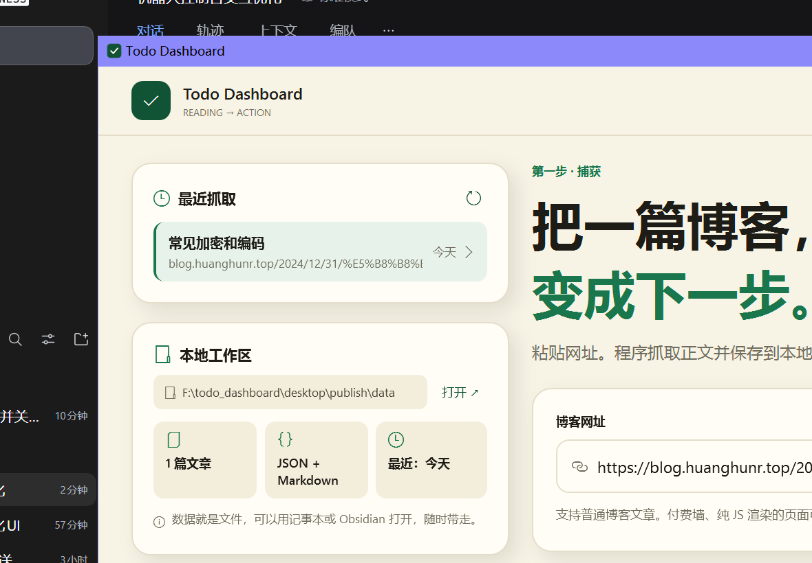
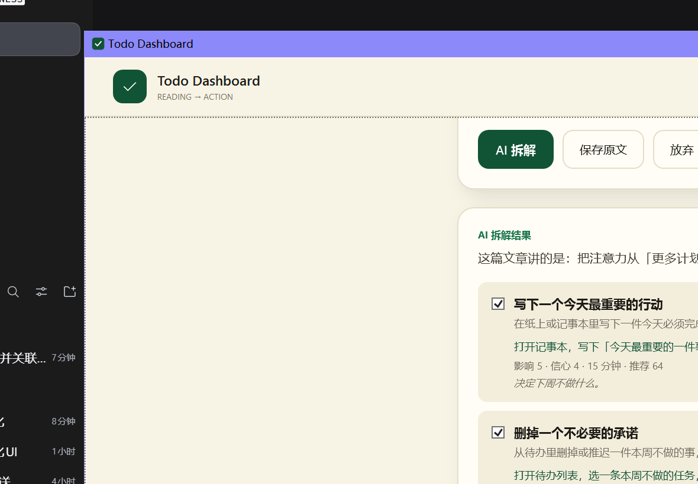

# Todo Dashboard

> 粘贴一篇博客，把它变成下一步。

一个 Windows 桌面的 **reading-to-action** 工具。它不做通用任务管理，而是把「读到的想法」压缩成少量可执行动作，让你只关注当前这一件。





## 现在能做什么

- 粘贴一篇博客的网址；
- 抓取标题、作者、发布日期、正文、字数；
- 先看预览，确认后再保存；
- 点「AI 拆解」，让 DeepSeek 把文章拆成 3–7 条可执行行动；
- 勾选要保留的行动，保存到 `data/actions/*.md`；
- 保存原文为 `data/sources/*.md` + `*.json`；
- 左栏显示最近抓取和本地工作区；
- 拦截 `localhost` 和内网地址，避免乱抓本机服务。

## API Key

- 第一次点「AI 拆解」时会弹窗输入 DeepSeek API Key；
- Key 保存在 Windows 凭据管理器，不写进项目文件；
- 开发/测试时也可以用环境变量 `DEEPSEEK_API_KEY`，它会优先于凭据管理器。

## 技术栈

- **.NET 8 + WPF**（Windows 原生界面）
- **AngleSharp** 解析 HTML
- 自包含单文件 exe，用户电脑不需要安装 .NET
- 数据是本地 JSON + Markdown，不锁进数据库

## 运行

需要 .NET 8 SDK。

```powershell
dotnet run --project desktop/TodoDashboard/TodoDashboard.csproj
```

## 打包成单个 exe

```powershell
dotnet publish desktop/TodoDashboard/TodoDashboard.csproj -c Release -r win-x64 `
  --self-contained true `
  -p:PublishSingleFile=true `
  -p:IncludeNativeLibrariesForSelfExtract=true `
  -o desktop/publish
```

产物：`desktop/publish/TodoDashboard.exe`。

## 数据放在哪

- 默认：exe 同目录的 `data/`（便携，整个文件夹可以拷走）；
- 开发时：仓库根目录的 `data/`；
- 也可以用环境变量 `TODO_DASHBOARD_DATA_DIR` 指定。

## 项目状态

- [x] 界面设计图确认
- [x] WPF 第一版：URL → 抓取 → 预览 → 保存
- [x] 真实博客端到端验证（抓取、预览、保存成功）
- [x] AI 拆解：DeepSeek → 3–7 条行动 → 勾选 → 保存（本地 mock 验证）
- [ ] 下一步：行动仪表盘（一个「现在做」+ 排序）

## 数据文件

- `data/sources/*.md` / `*.json`：抓取的文章；
- `data/actions/*.md`：AI 拆解后你确认保留的行动，带 YAML frontmatter；
- 全部是普通文件，可以直接用 Obsidian / 记事本打开。

## 文档

- [界面需求说明](design/REQUIREMENTS.md) — 给设计师看的版本
- [项目章程](docs/CHARTER.md) — 为什么做、为谁做、不做什么
- [PRD](docs/PRD.md) — v0.2，已确认
- [方法论](docs/METHODOLOGY.md) — GTD、Personal Kanban、ICE/WSJF、执行意图
- [工程规范](docs/ENGINEERING.md) — 分支、提交、质量门禁与协作约定
- [ADR-0002](docs/adr/0002-wpf-desktop.md) — 改用 .NET 8 + WPF（当前方案）
- [已知问题](docs/KNOWN_ISSUES.md) — WebView2 问题的历史记录

## 说明

Tauri + React 的原型保留在 `src-tauri/`、`src/`，不再作为主路径；改用 WPF 的原因见 [ADR-0002](docs/adr/0002-wpf-desktop.md)。

## License

[MIT](LICENSE)
