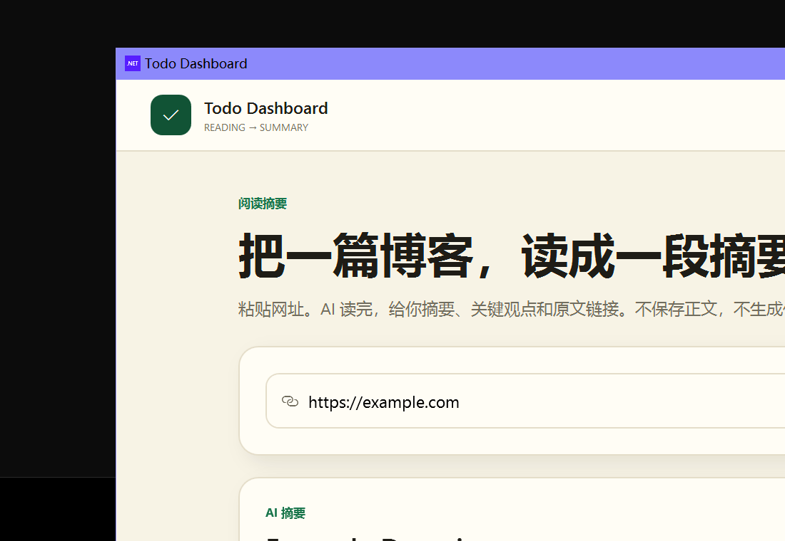

# Todo Dashboard

> 粘贴一篇博客，AI 给你一段摘要。

一个 Windows 桌面小工具：**粘贴网址 → 抓取正文 → AI 摘要 → 打开原文链接**。

不保存正文，不生成任务，不做行动板，不做周复盘。



## 现在能做什么

- 粘贴一个博客网址；
- 抓取标题、作者、发布日期、正文（只在内存里，不落盘）；
- DeepSeek 生成：
  - 一段摘要；
  - 「文章在讲什么」的通俗讲解；
  - 3–5 条关键观点；
  - 适合谁读、一句阅读建议；
- 点「打开原文 ↗」直达原博客；
- 不保存正文，不生成任务，不拆解行动。

## API Key

- 第一次生成摘要时弹窗输入 DeepSeek API Key；
- Key 保存在 Windows 凭据管理器，不写进项目文件；
- 开发/测试时也可以用环境变量 `DEEPSEEK_API_KEY`，它会优先于凭据管理器。

## 技术栈

- **.NET 8 + WPF**（Windows 原生界面）
- **AngleSharp** 解析 HTML
- **DeepSeek** 生成摘要和讲解
- 自包含便携版，用户电脑不需要安装 .NET

## 运行

需要 .NET 8 SDK。

```powershell
dotnet run --project desktop/TodoDashboard/TodoDashboard.csproj
```

## 打包成便携版

```powershell
dotnet publish desktop/TodoDashboard/TodoDashboard.csproj -c Release -r win-x64 `
  --self-contained true `
  -p:PublishSingleFile=false `
  -o desktop/publish-portable
```

把 `desktop/publish-portable` 整个文件夹（或 `TodoDashboard-portable.zip`）发给用户，双击 `TodoDashboard.exe` 即可。

## 如果双击 exe 没反应

请用文件夹版 `TodoDashboard-portable.zip`，不要用单文件版。单文件版启动时要把 WPF 组件解压到系统临时目录；临时目录被权限限制时会没有反应。

## 数据

- 不保存文章正文；
- 不建本地数据库；
- 关闭程序后，只剩你主动打开的原文链接。

## 项目状态

- [x] URL → 抓取 → AI 摘要 → 原文链接
- [x] 摘要、讲解、关键观点、适合谁、阅读建议
- [x] 单窗口、米白简约风
- [ ] 用真实 DeepSeek Key 跑几篇，打磨摘要质量

## 文档

- [项目章程](docs/CHARTER.md) — 为什么做、为谁做
- [PRD](docs/PRD.md) — 历史需求；顶部有最终简化说明
- [工程规范](docs/ENGINEERING.md) — 分支、提交、质量门禁与协作约定
- [ADR-0002](docs/adr/0002-wpf-desktop.md) — 改用 .NET 8 + WPF

## License

[MIT](LICENSE)
